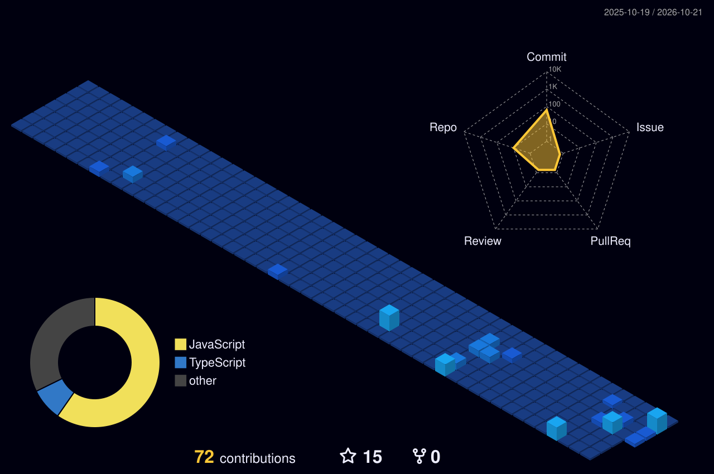

---

## `> whoami`

I'm **Mukim Shah**, an AI-focused developer from Ahmedabad, India. I build backend services, AI agents, and workflow automations that connect APIs, data, and everyday business processes.

- 🤖 **AI & LLMs:** AI agents, LLM API integrations, structured outputs, evaluation and fallback handling
- ⚙️ **Automation:** n8n, workflow design, API integrations, WhatsApp automation
- 🧩 **Backend:** Node.js, Express, TypeScript, Python, REST APIs
- 🗄️ **Data:** SQLite, Prisma, Supabase and data validation
- 🌐 **Frontend:** React, Vite, Tailwind CSS
- 🚀 **Current focus:** reliable AI backends, practical automation, and production-minded projects

> Turning ideas into useful, maintainable systems — one workflow at a time.

---

## `> tech-stack`

 

---

## `> featured-projects`

### More projects

- [Website Data Scraping Agent](https://github.com/mukim-shah/website-data-scraping-agent)
- [WhatsApp Food Ordering AI Agent](https://github.com/mukim-shah/whatsapp-food-ordering-ai-agent)

---

## `> engineering-log`

### FlyRank — Backend AI Engineering Internship

A structured backend engineering portfolio covering API development, data persistence, responsible scraping, and LLM-powered triage.

- **API fundamentals:** Express endpoints and request/response handling
- **CRUD & persistence:** validation, modular routes, SQLite and prepared statements
- **Responsible scraping:** extraction, normalization, validation, caching and run reports
- **LLM triage:** versioned prompts, schema validation, controlled retries, repair attempts, fallback modes and structured logs

Explore the [full internship repository](https://github.com/mukim-shah/flyrank-backend-ai-internship).

---

## `> github-activity`

 

---

## `> contribution-animations`

### 🐍 Contribution Snake

<picture>
<source media="(prefers-color-scheme: dark)" srcset="assets/github-snake-dark.svg" />
<source media="(prefers-color-scheme: light)" srcset="assets/github-snake.svg" />

</picture>

### 🧊 3D Contribution Graph

---

## `> connect`

I'm interested in **AI development, backend engineering, and automation projects**.

- 🌐 Website: [quickautomate.in](https://quickautomate.in)
- 💼 LinkedIn: [Mukim Shah](https://www.linkedin.com/in/mukim-shah-377825334/)
- 📍 Ahmedabad, Gujarat, India

<b>BUILD.</b> &nbsp; <b>AUTOMATE.</b> &nbsp; <b>INNOVATE.</b>

